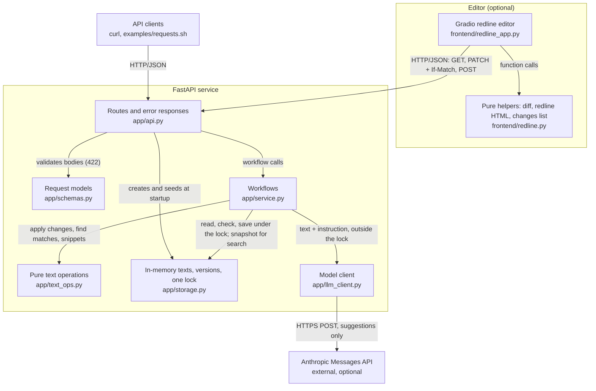

# Document redline and search service

A small Python and FastAPI service that applies lists of text changes to a
document and searches documents for a phrase, returning snippets around each
match. Optional extras: a redline editor and an LLM edit suggestion.

It is a deliberate prototype: in memory, one process, no login. I put
correctness first; [Scope, limitations, and trade-offs](#scope-limitations-and-trade-offs)
lists what I deferred and why.

## Assessment deliverables

- **Part I, Take-Home App Build:** service in `app/`, tests in `tests/`,
  sample requests in `examples/requests.sh`, benchmark in `scripts/`, optional
  editor in `frontend/`. See [Quick start](#quick-start),
  [API reference](#api-reference), and [Performance](#performance).
- **Part II, Infra Thinking & Assessment:** [docs/INFRA.md](docs/INFRA.md),
  the production design and phased plan.

## Quick start

Two terminals: the API and the editor. Requires Python 3.12 or newer (tested
with 3.12.11 on macOS). From the repository root:

```bash
python3.12 -m venv .venv
.venv/bin/pip install -r requirements-frontend.txt -e .

# Terminal 1: the API
.venv/bin/uvicorn app.api:app --port 8000 --no-access-log

# Terminal 2: the redline editor
.venv/bin/python -m frontend.redline_app
```

Then open:

- **Redline editor:** <http://127.0.0.1:7860>. Edit a document and see
  deletions struck through and insertions underlined; Save sends one PATCH.
- **Interactive API docs:** <http://127.0.0.1:8000/docs>.

`requirements-frontend.txt` adds Gradio to the exact pins in
`requirements.txt` (enough for the API alone). The API loads three synthetic
documents from `sample_documents/` (`nda-acme`, `msa-globex`,
`lease-initech`) into memory; a restart resets every edit.

**Optional AI suggestions.** Start the API from a shell with a key:

```bash
export ANTHROPIC_API_KEY="your-anthropic-api-key"
.venv/bin/uvicorn app.api:app --port 8000 --no-access-log
```

Without a key, only suggestion requests get a 503; everything else works.

### Tests, benchmark, and sample requests

```bash
.venv/bin/python -m pytest                # includes 10 MiB document tests
.venv/bin/ruff check . && .venv/bin/ruff format --check .
.venv/bin/python scripts/benchmark.py     # timings on a 10 MiB document
bash examples/requests.sh                 # 37 curl requests; API must be running
```

With only `requirements.txt` installed, pytest reports 383 passed and 1
skipped (`tests/test_frontend_app.py` needs Gradio); with
`requirements-frontend.txt` installed too, 406 passed. `requests.sh` edits
documents, so restart the API before each run.

## Architecture

A redline service is only as trustworthy as its edit logic, so each layer is
its own small module and the text logic is pure functions that tests call
directly.



| Path | Owns |
| --- | --- |
| `frontend/redline_app.py` | Gradio page and its HTTP calls |
| `frontend/redline.py` | Word diff, redline HTML, the PATCH `changes` list |
| `app/api.py` | Routes, `ETag` and `If-Match`, error body |
| `app/schemas.py` | Strict request models (422) |
| `app/service.py` | Workflows; holds the lock from version check to save |
| `app/text_ops.py` | Pure matching, change application, snippets |
| `app/storage.py` | Texts, versions, the lock, sample loading |
| `app/llm_client.py` | The only code that calls the model |

A Save in the editor: `redline_app.py` builds the `changes` list with
`redline.py` and sends one PATCH with `If-Match`. Under the lock,
`service.py` reads the text (404), compares versions (412), and has
`text_ops.apply_changes` apply each change to a copy (any failure is a 409,
nothing saved), then saves once and returns the new `ETag`.

## API reference

Clients need to know exactly what each call does and how it fails, so I used
plain REST (GETs read, PATCH edits, POST suggests without saving) and one
JSON error shape.

| Method and path | Purpose | Success |
| --- | --- | --- |
| `GET /documents` | List document IDs and lengths | 200 |
| `GET /documents/{document_id}` | Read one document | 200, with `ETag` |
| `PATCH /documents/{document_id}` | Apply a list of changes, all or nothing | 200, with `ETag` |
| `GET /documents/search` | Search one, several, or all documents | 200 |
| `POST /documents/{document_id}/suggestions` | Ask the model for one edit (optional) | 200 |

`GET /documents` returns `{"documents": [{"document_id": str, "length": int}, ...]}`;
`GET /documents/{document_id}` returns `{"document_id": str, "text": str}`.

### Example requests

Run in order on a fresh server (actual responses). The first fails whole
because its second change is ambiguous.

```bash
curl -sS -X PATCH http://127.0.0.1:8000/documents/nda-acme \
  -H 'Content-Type: application/json' \
  -d '{"changes": [
        {"operation": "replace", "target": {"text": "within 30 days"}, "replacement": "within 60 days"},
        {"operation": "replace", "target": {"text": "Confidential Information"}, "replacement": "Proprietary Information"}
      ]}'
# 409 {"error":"changes.1: Target text appears 2 times in document 'nda-acme'; specify occurrence 1 to 2.","code":409}

curl -sS -X PATCH http://127.0.0.1:8000/documents/nda-acme \
  -H 'Content-Type: application/json' \
  -d '{"changes": [
        {"operation": "replace", "target": {"text": "Receiving Party", "occurrence": 2}, "replacement": "Recipient"},
        {"operation": "replace", "target": {"text": "30 days", "range": {"start": 123, "end": 130}}, "replacement": "60 days"}
      ]}'
# 200 {"document_id":"nda-acme","changes":[{"start":64,"occurrence":2},{"start":123,"occurrence":null}],"text":"The Receiving Party shall protect Confidential Information. The Recipient shall return all Confidential Information within 60 days.\n"}

curl -sS -G http://127.0.0.1:8000/documents/search \
  --data-urlencode "q=Confidential Information" \
  --data-urlencode "document_id=nda-acme" \
  --data-urlencode "limit=1"
# 200 {"query":"Confidential Information","total_matches":2,"results":[{"document_id":"nda-acme","start":34,"end":58,"before":"The Receiving Party shall protect ","match":"Confidential Information","after":". The Recipient shall return all Confide"}]}
```

### `PATCH /documents/{document_id}`

Body: `{"changes": [<change>, ...]}`, 1 to 100 changes, applied in order.

| Field | Meaning |
| --- | --- |
| `operation` | `"replace"`, the only operation |
| `target.text` | Text to replace; with `range`, the text expected there |
| `target.occurrence` | Optional: which match to replace, counting from 1 |
| `target.range` | Optional: `{"start", "end"}`, a span to replace instead of a search match |
| `replacement` | New text; empty deletes |

An insertion is a zero-width range with empty text:
`{"operation": "replace", "target": {"text": "", "range": {"start": 0, "end": 0}}, "replacement": "CONFIDENTIAL. "}`.

Response: `{"document_id": str, "changes": [{"start": int, "occurrence": int | null}, ...], "text": str}`:
where each change applied, which match (`null` for a range), and the new text.

**Version checks.** The `ETag` is the document's version (`"1"` at startup,
plus one per save). A stale `If-Match` gets a 412; without one, nothing is
checked.

### `GET /documents/search`

| Query parameter | Meaning |
| --- | --- |
| `q` | Required: literal text to find |
| `document_id` | Repeatable; omit to search all documents |
| `limit` | Results to return, 1 to 100, default 10 |
| `offset` | Matches to skip, default 0 |
| `ignore_case` | `true` to ignore case, default `false` |

Response: `{"query": str, "total_matches": int, "results": [{"document_id": str, "start": int, "end": int, "before": str, "match": str, "after": str}, ...]}`.

### `POST /documents/{document_id}/suggestions` (optional LLM)

Body: `{"instruction": "Give the recipient 60 days instead of 30"}`. Sends the
document and instruction to Claude Haiku 5.5 (one Anthropic Messages API call,
structured output) and checks the proposed edit against the document. It
**never saves**.

Response: `{"document_id": str, "suggestion": <change>, "explanation": str, "applies": bool, "match_count": int, "reason": str | null}`.
If `applies` is true, a person can send `{"changes": [suggestion]}`;
otherwise `reason` says why. A sample call took about 2 seconds and cost about
$0.00009. Tests stub the network call.

### Errors

Every error body is `{"error": "<message>", "code": <HTTP status>}`.
Messages name the failing field (`changes.1` is the second change) and never
include document text. Checks run in the order 422, 404, 412, 409.

| Status | When |
| --- | --- |
| 404 | Unknown document or route |
| 409 | Target missing, repeated without `occurrence`, or not at `range`; suggestion document over 50,000 characters |
| 412 | Stale `If-Match` |
| 422 | Bad JSON or fields, empty `q` or `target.text` (except insertions), `occurrence` with `range` |
| 500 | Unexpected server error |
| 502, 503 | Suggestions: model failure or 30 s timeout (502); no `ANTHROPIC_API_KEY` (503) |

## Edit and search semantics

Legal edits must never land in the wrong place, so every change names the
exact text it replaces and the whole batch is all or nothing. Search uses the
same literal matching, so what you find is what you can edit.

- **Literal and case-sensitive.** No regex, Unicode normalization, quote
  folding, or whitespace collapsing.
- **Non-overlapping, left to right:** `"aaaa"` contains `"aa"` twice.
- **Positions** are Python string indices: Unicode code points, `end`
  exclusive (not UTF-8 bytes or UTF-16 units).

### Edits

- **In order.** Each change applies to the text left by the previous ones.
- **Exact targets.** Without `occurrence`, `target.text` must appear exactly
  once. With `range`, it must equal the text in that span, so the
  assignment's position-only example is a 422 until it adds the expected text.
- **Insertions** have no expected text; only `If-Match` catches a changed
  document.

### Search

- An unknown `document_id` is a 404, so a typo cannot look like "no matches".
  `search` itself cannot be a document ID (it is the route).
- Results are ordered by document, then position. Each page rescans, so an
  edit between pages can shift matches.
- Snippets hold up to 40 characters on each side of the match, clipped at the
  document's edges, with no ellipsis or word-boundary adjustment.
- `ignore_case` lowercases each character on its own, so positions still point
  into the original text. It is not full Unicode case folding.

## Performance

Contracts can be long, so I measured plain linear scans on a 10 MiB document
instead of claiming they're fast, including the case where they aren't.

`scripts/benchmark.py` on Python 3.12.11, macOS 26.5, Apple M3, 8 GB RAM, with a
generated 10,485,800-character document (one paragraph repeated 78,252
times). Medians of 5 runs; peak memory from `tracemalloc`.

| Operation | Median time | Peak memory |
| --- | --- | --- |
| Find `Supplier` (78,252 matches) | 13.91 ms | 2.82 MB |
| Find `' '` (1,956,302 matches) | 215.35 ms | 71.90 MB |
| One change: a unique target near the end | 6.08 ms | 41.94 MB |
| 100 changes, each a unique target near the end | 450.83 ms | 62.95 MB |
| Search `supplier`, `ignore_case` | 44.19 ms | 146.80 MB |
| Search `supplier`, `ignore_case`, text containing one `İ` | 645.79 ms | |
| HTTP PATCH through `TestClient` (full text in response) | 57.08 ms | |

One machine, November 1, 2026; not guaranteed limits. **Known slow case:** a
one-off run (not part of the script) of 100 changes that each replace a space
with a space (`target.text` `" "`, `occurrence` 1 to 100) on the same document
took 22.13 s, about 221 ms per change, because every change collects all 1.96
million space positions. The request holds the lock throughout, so every other
edit waits that long.

- **Linear scans.** Changes by text and searches run `str.find` and collect
  every match, so cost grows with document size and match count. Each change
  copies the string, and encoding the full text is most of the HTTP time.
- **No index.** Search matches any substring (`ty shall pro` is valid), which
  a word-level inverted index cannot answer, and every PATCH would have to
  update it.

`tests/test_large_documents.py` checks correctness on the same document.

## Scope, limitations, and trade-offs

I scoped this to get correctness right first: no edit is guessed or
half-applied, and no stale save overwrites newer work when `If-Match` is sent.
The rest a production service needs, I deferred on purpose.

**What I chose on purpose:**

- **A list of changes, all or nothing,** so one request carries a reviewer's
  edits and later changes can build on earlier ones.
- **Never guess which text to edit.** Legal documents repeat boilerplate, and a
  bare position hits the wrong words after another edit, so an ambiguous or
  stale target is a 409.
- **Suggestions never save.** Model output varies and documents could carry
  injected instructions, so a person applies every edit.
- **No document text in errors or access logs,** since search URLs contain
  search terms.

**What I deferred, and why:**

| Today | Trade-off | Why I deferred it |
| --- | --- | --- |
| In memory; a restart resets documents and versions | No setup; nothing survives a restart | Test data is enough here; durable storage is step one in production |
| One process, one lock for all edits | Edits run one at a time, but a slow edit blocks the rest (the 22 s case) | Correct at this size; a database with version-checked writes replaces it |
| `If-Match` is optional | Easy curl edits; a client can skip the stale-edit check | The editor always sends it |
| No login, tenants, or audit log | Fine for a local demo, not for client documents | Needs an identity provider and data rules |
| Search scans text on every request | Any substring, always current; cost grows with size | Three documents (see [Performance](#performance)) |
| Synchronous LLM call, no retry | Simple; holds a thread for seconds and sends the text to a third party | Optional feature; needs deadlines, retries, and data agreements |
| Literal matching, fixed 40-character snippets | Predictable positions; curly quotes miss straight ones, snippets can cut words | Normalizing would need a map back to original positions |

**Where it goes next.** In production I'd fix these in priority order: data
integrity and durability (a database, an edit log, required `If-Match`), then
security, privacy, and compliance (SSO, tenant isolation, audit logs), then
reliability and scale, then operability and cost.
[docs/INFRA.md](docs/INFRA.md) has the design and the phased plan.
