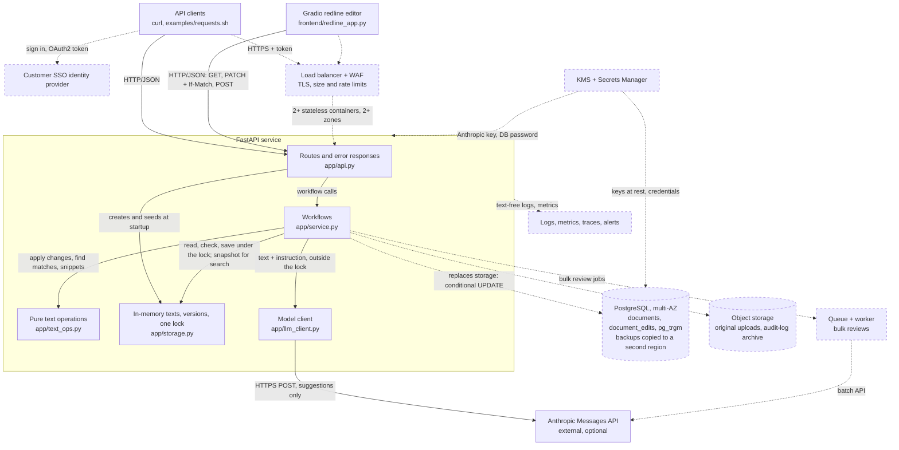
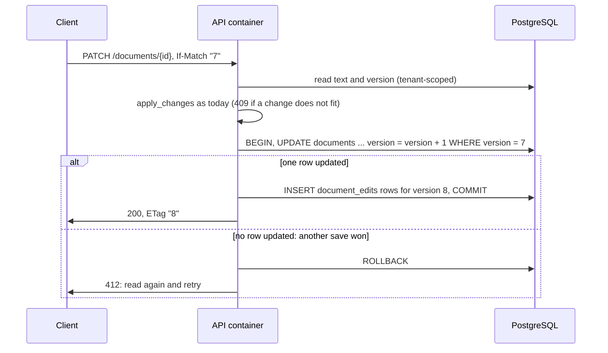

# Production infrastructure design

## Key assumptions

**A1. Business and users**

- Law firms and legal teams redline contracts against deadlines.
- Correct, attributable edits outrank raw speed.
- A person accepts every model suggestion.

**A2. Data and compliance**

- Privileged client documents; no tenant may see another's.
- Customers expect SOC 2 and GDPR answers; some require data residency.
- The model provider neither trains on nor retains our text.

**A3. Workload and scale (assumed, not measured)**

- Tens to hundreds of firms; up to tens of thousands of users.
- Most contracts are under 1 MB; the README benchmark tested 10 MiB.
- Reads and searches far outnumber edits; a few suggestions per user per day.

**A4. Infrastructure and technology**

- AWS, managed services by default.
- Keep the Python/FastAPI service and its layers; PostgreSQL replaces the
  storage module as the system of record.

**A5. Team and operations**

- A small team: low operational burden beats fine-grained control.
- Model spend is the main variable cost.

## Prototype scope and deferred work

My priority was the core requirements: correct redlining (precise,
all-or-nothing edits that never land in the wrong place), search across
documents, and a basic LLM integration. I deferred everything else by three
rules: it doesn't change whether an edit is correct; it needs real customers,
traffic, or an environment to decide well (identity provider, tenants,
regions, load); and today's code has a clear seam to add it later (the
storage module, the service layer, the model client).

| Limitation today | Why it was right for the take-home | Fixed in |
| --- | --- | --- |
| Texts and versions in Python dicts: a restart loses every edit; no edit history | No setup for reviewers | §1 |
| One process, one `threading.Lock`: 100 space-targeting changes hold it about 22 s on a 10 MiB document. `If-Match` is optional (missing or `*` skips the check) | One lock makes all-or-nothing edits and version checks easy to prove; the editor sends `If-Match` | §1, §3 |
| Search scans the full text: about 14 ms for 78,252 matches on 10 MiB | Any literal substring works, measured fast; no index to sync | Phase 4 |
| One synchronous model call, no retries; failures are a 502 | Suggestions never save, so a failure loses nothing | §3 |
| No auth, tenants, audit log, CI, metrics, or cost limits | No real users, data, or traffic yet | §2 to §4 |

## How I'd order the work

Given A1 and A2, a lost or leaked redline is the worst failure, so I rank
the work by risk, highest first:

1. **Data integrity and durability:** PostgreSQL, required `If-Match`, an
   edit log.
2. **Security, privacy, and compliance:** SSO, tenant isolation, audit.
3. **Reliability and scale:** zones, autoscaling, timeouts, canaries.
4. **Operability and cost:** text-free telemetry, model budgets.

The sections follow this order. **Everything below is proposed.**

## Target architecture and infrastructure

Lawyers can't lose edits to a restart, so I'd use the standard stateless
pattern: containers in several zones, all state in managed storage.

Solid boxes and arrows exist today; dashed boxes and dotted arrows are
proposed.

### Key decisions and alternatives

A small team (A5) should build legal features, not run servers, so I
default to managed services.

| Decision | Chosen | Alternatives | Why |
| --- | --- | --- | --- |
| Compute | ECS Fargate, 2+ zones, ALB + WAF | EKS; Lambda; EC2 | No cluster or hosts, at a higher vCPU price; Lambda's 6 MB buffered response is below a 10 MB document |
| Storage | RDS PostgreSQL, multi-AZ; S3 for uploads and audit archive | DynamoDB; S3 only | Version and history in one transaction; row-level security; DynamoDB caps items at 400 KB. Multi-AZ about doubles cost; each save rewrites the text |
| Conflicting edits | Required `If-Match` (428 without), conditional `UPDATE` | Row lock (`FOR UPDATE`) | Today's lock can't span containers; a row lock holds a connection through a slow edit |
| Tenancy | Shared tables keyed by `tenant_id`; row-level security as backstop | Schema or database per tenant | One schema to migrate, one pool to size |
| Auth | Customer SSO (OIDC/OAuth2); tokens carry tenant and role | Local passwords; static API keys | Firms keep their own MFA and offboarding; scripts use client credentials |
| Search | Tenant-scoped scan; a `pg_trgm` prefilter when latency requires | Inverted index; OpenSearch | Literal-substring queries; OpenSearch is a second copy to secure and sync, worth it for fuzzy or ranked search |
| Caching | `ETag`/`If-None-Match` (304), gzip | Redis | Every edit invalidates a cached text |
| LLM calls | Suggestions synchronous; bulk reviews via the provider's batch API | All synchronous; all queued | Suggestions are interactive; batch is cheaper and frees request threads |
| Regions | One region per residency zone; backups in a second region there | Active-active | Two-region editing needs conflict resolution; a lost region means a slower restore |

## 1. Data integrity and durability

Client work product (A2) means every edit must be durable, attributable,
and replayable; I'd use the standard transactional database, optimistic
concurrency, and an append-only edit log.

- `document_edits`: one row per applied change, keyed by `(tenant_id,
  document_id, version, change_index)`, with `start`, `old_text`, `new_text`,
  `actor`, `time`, and `source` (accepted suggestions). Replay rebuilds any
  version from the upload.
- The save is one conditional transaction; a slow edit blocks nobody:

- **Stale suggestions:** `applies: true` holds for the model's snapshot; sent
  with its `ETag`, PATCH returns 412 if the text changed.
- **Search paging:** edits shift later matches, so `offset` and position
  cursors drift; a cursor holding document versions can return 409 instead.

## 2. Security, privacy, and compliance

One cross-customer leak would end the product, so I'd follow the standard
SaaS baseline.

- **Access:** viewer and editor roles. Every query is tenant-scoped (another
  tenant's document is a 404), search included, since snippets expose text.
- **Encryption:** TLS; KMS keys for data and backups; the Anthropic key and
  database password in Secrets Manager, rotated.
- **Audit:** edit history plus a write-once log of reads, searches, and
  suggestions (IDs only).
- **LLM data:** opt-in per tenant, under A2's provider terms, in-region
  where required.
- **GDPR/SOC 2:** deletion includes history; backups expire; residency per
  region. These support an audit; they are not compliance.

## 3. Reliability and scale

Deadlines (A1) mean editing and search must survive outages and bad
releases; I'd use standard redundancy, timeouts, and canaries.

**Scalability and resilience**

- Autoscale on CPU; scans are CPU-bound and single-core under the GIL, so
  1-vCPU containers.
- Multi-AZ database failover; writes fail briefly while it switches.
- **LLM:** a 20 s total deadline, one jittered retry on 429/529, and a circuit
  breaker returning 503.

**CI/CD and deployment**

- Pull requests: ruff, pytest with a mocked LLM, a dependency audit, a
  pinned image.
- Staging: expand-then-contract migrations and the `examples/requests.sh`
  smoke test, then a 10% canary rolled back on 5xx or latency alarms.

## 4. Operability and cost

Nobody should read a client's document to debug, so telemetry stays
text-free, and model spend (A5) gets hard budgets.

**Monitoring and observability**

- JSON logs: request ID, tenant, document ID, status, latency.
- Metrics: rate, errors, latency per route; 409/412 rates; LLM latency,
  tokens, cost, `applies: false` rate. Traces across API, database, model.
- Alerts: 5xx rate, p95 latency, open LLM circuit, overspending, failed backups.

**Operations and cost**

- **LLM:** about $0.0001 per call measured, $0.002 estimated at the
  50,000-character cap. Per-tenant token budgets, per-user rate limits, and a
  provider spend cap.

## Build plan: if I were to build this, in this order

No client document goes in before it is durable and private, and nothing
scales before we can see it, so I phase by dependency, each with an exit check.

| Phase | Goal | What ships | Why now | Exit criterion |
| --- | --- | --- | --- | --- |
| 1. Durable and private | No lost or leaked edit | §1 and §2; PR checks; a provider spend cap | Every later phase assumes durable, tenant-scoped data | A tested restore replays the log to a known version; stale saves get 412; cross-tenant reads get 404 |
| 2. Visible and safe to ship | See failures; undo bad releases | §4 telemetry and alerts; §3 staging and canary | We can't scale what we can't see; canaries need alarms | A bad build rolls back by itself; each alert fires in a drill |
| 3. Resilient under load | Survive load and outages | §3 autoscaling and model failure handling; bulk-review queue | Phase 2 metrics show where load and failures are | The smoke test passes with the model down; p95 holds at expected peak |
| 4. Cost-controlled growth | Spend tracks usage | §4 budgets; right-sizing; a trigram index or new regions when metrics or contracts require | Limits need real usage to set | Per-tenant spend is visible and capped |

**Deferred until a customer needs them:** the decision table's alternatives
and per-tenant keys.
